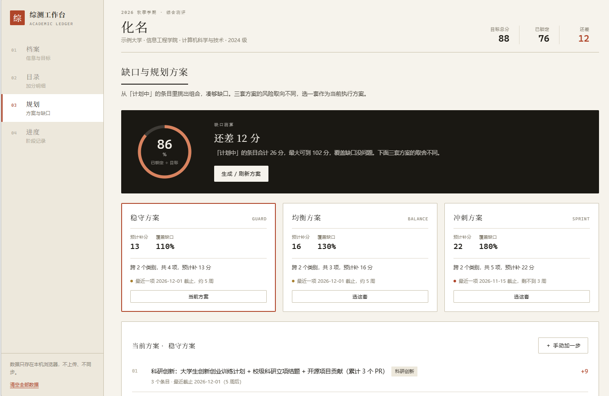
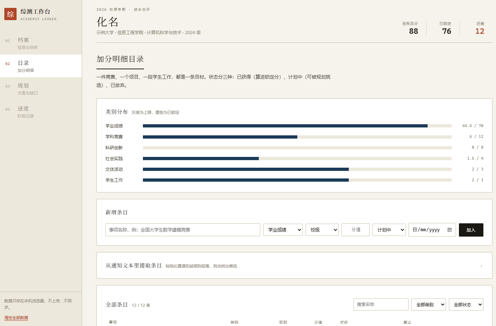
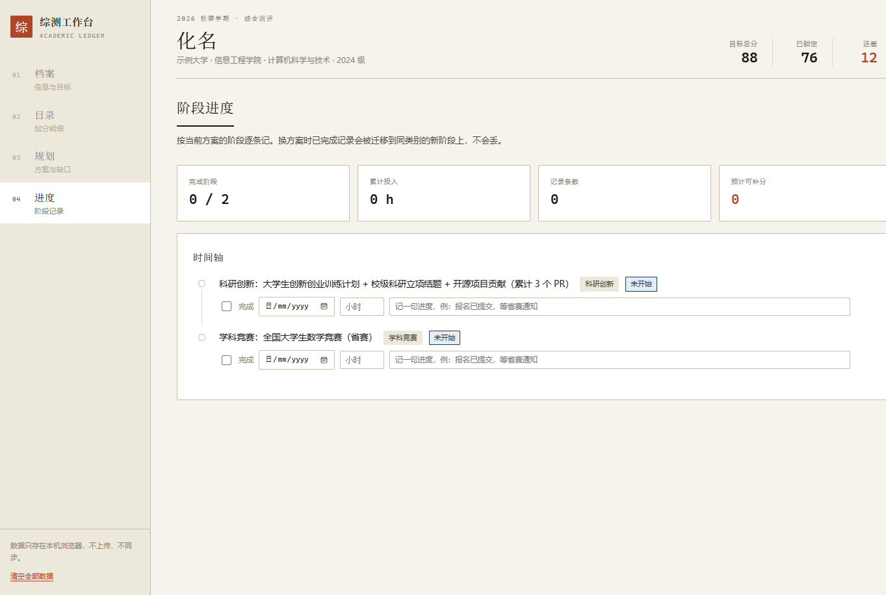

# 综测工作台

> 大学生综合素质测评（综测）的规划与追踪工具 —— 用 [WorkBuddy](https://www.workbuddy.cn) AI 对话式开发完成，全程零手写框架依赖。

**在线体验**：[zongce-workbench-84848.app.workbuddy.host](https://zongce-workbench-84848.app.workbuddy.host/?sharecode=UAEM22HSJO)
　**备用镜像**：[panjiang429.github.io/zongce-workbench](https://panjiang429.github.io/zongce-workbench/)

（内置虚构示例数据，点左下角「清空全部数据」即可录入自己的档案；所有数据仅存于浏览器本地，不上传服务器。）

## 它解决什么问题

综合测评的典型痛点：细则分散、算分靠期末手算、加分项东一件西一件没有全局视图。综测工作台把这件事变成一条可管理的链路：

```
档案（锁定差距） → 目录（明细管理） → 规划（三套方案） → 进度（打卡追踪）
```

| 板块 | 功能 |
|---|---|
| **01 档案** | 录入目标总分、已确定得分、六个评分类别的分值上限；实时校验类别上限之和是否凑满 100 分 |
| **02 目录** | 加分明细表 + 类别分布条形图；**粘贴竞赛通知文本自动提取候选条目**；按类别 / 状态 / 关键词筛选，行内改状态 |
| **03 规划** | 缺口环形图；根据分差自动生成 **稳守 / 均衡 / 冲刺** 三套方案，各自标注预计补分、覆盖类别与风险提示（临近截止的条目在稳守方案中自动降权） |
| **04 进度** | 按阶段勾选打卡、记录日期与投入时长；**切换方案时已完成记录自动迁移**，不丢数据 |

## 界面预览

**规划页** —— 缺口环形图与三套方案卡：



**目录页** —— 类别分布与明细表：



**进度页** —— 阶段时间轴与打卡记录：



## 技术实现

- **纯前端，零依赖**：无框架、无构建工具、无 CDN，`index.html` 双击即可运行
- 原生 JavaScript 模块化分层：`store.js`（localStorage 持久化）/ `plan.js`（确定性规则引擎，生成三套规划方案）/ `app.js`（视图渲染与交互）
- 手写 SVG 环形图与 CSS 条形图，未引入任何图表库
- 响应式布局，移动端可用
- 隐私优先：不设后端、不设账号体系，数据全部留在用户浏览器本地

## 运行

```bash
# 方式一：直接双击 index.html

# 方式二：本地起服务
python -m http.server 8765
# 打开 http://127.0.0.1:8765
```

## 开发方式

本项目由 AI 对话式开发工具 WorkBuddy 在约 3 小时内从需求描述到上线完成，包括功能设计、编码、jsdom 自动化冒烟测试与发布部署。

---

*示例数据（化名 / 示例大学）均为虚构，仅用于演示，不代表任何学校的真实测评标准。*
